  

  

  

    
    
    
  

## About

I'm a **Software Engineer at [Attend](https://attend-jet.vercel.app/)** and a final-year **BS Artificial Intelligence** student at **Bahria University, Islamabad**. I build machine learning systems and the products around them.

Previously: ML Engineering Intern at **FlyRank AI** and Full-Stack Dashboard Intern at **SigmaE Global**.

## Stack

  

## Projects

| Project | What it is | Built with |
| :-- | :-- | :-- |
| [**Attend**](https://attend-jet.vercel.app/) | Event discovery, participation and campaign platform. The event is the destination, with a promotional layer for organizers and advocates. | `Next.js` `Supabase` `Tailwind` |
| [**Redline**](https://github.com/Sanaullah-Turab/redline) | F1 prediction app with automated race scoring. | `Next.js` `Drizzle` `Supabase` |
| [**Slipstream**](https://github.com/Sanaullah-Turab/slipstream) | Multi-agent RL racing where agents learn to overtake and defend. | `PPO` `PettingZoo` `Pygame` |
| [**FlareWatch**](https://github.com/SigmaE-Global/flarewatch) | Satellite gas flaring monitor with map analytics. | `Next.js` `Supabase` |

## Activity

  
    
  <picture>
    <source media="(prefers-color-scheme: light)" srcset="https://raw.githubusercontent.com/Sanaullah-Turab/Sanaullah-Turab/output/github-contribution-grid-snake.svg"/>
    
  </picture>

  
  

