  

  

  

    
    
    
  

 

  
Final-year <b>BS Artificial Intelligence</b> student at <b>Bahria University, Islamabad</b>. 
  I build machine learning systems and the products around them.

  ML Engineering Intern at <b>FlyRank AI</b> &nbsp;·&nbsp; Full-Stack Dashboard Intern at <b>SigmaE Global</b> &nbsp;·&nbsp; Open source in <code>awslabs/mcp</code>
    
  <i>"Models are the easy part. Shipping them is the work."</i>

 

<h3 align="center">Stack</h3>

  
  
  
  
  
  
  
  
   
  
  
  
  
  
  
  
  

 

<h3 align="center">Featured Projects</h3>

  <a href="https://github.com/Sanaullah-Turab/redline"><b>Redline</b></a> &nbsp;F1 prediction app with automated race scoring 
  <code>Next.js</code> <code>Supabase</code> <code>Drizzle</code>
    
  <a href="https://github.com/Sanaullah-Turab/slipstream"><b>Slipstream</b></a> &nbsp;Multi-agent RL racing with overtaking and defending 
  <code>PPO</code> <code>PettingZoo</code> <code>Pygame</code>
    
  <a href="https://github.com/SigmaE-Global/flarewatch"><b>FlareWatch</b></a> &nbsp;Satellite gas flaring monitor with map analytics 
  <code>Next.js</code> <code>Supabase</code>
    
  <a href="https://sanaullahturab.vercel.app"><b>Portfolio</b></a> &nbsp;Editorial, blueprint-style personal site 
  <code>Next.js</code> <code>Framer Motion</code>

 

<h3 align="center">Activity</h3>

  
   
  
  
    
  <picture>
    <source media="(prefers-color-scheme: light)" srcset="https://raw.githubusercontent.com/Sanaullah-Turab/Sanaullah-Turab/output/github-contribution-grid-snake.svg"/>
    
  </picture>

 

  Open to AI/ML roles, research collaborations and open source work.
  

